# Munshi — your shop's back office, on voice

**Munshi is an AI assistant for kirana and small-shop owners.** Talk to it in Hindi, Hinglish or English, the way you would talk to a trusted munshi-ji behind the counter. Tell it what you need once, and it does the paperwork, the phone calls and the reminders. **Nothing involving money happens until you say "haan".**

### 👉 Try it now: **[munshi-web-navy.vercel.app](https://munshi-web-navy.vercel.app)**
Tap **Try the live demo**. No signup is needed. It opens *Kumar General Store*, a ready-made shop with three months of Paytm sales, a ledger of customers who owe money, stock levels and suppliers. On a phone, use Chrome's **Install app** option to put Munshi on your home screen.

<table align="center"><tr>
<td width="72%" align="center"> Desktop</td>
<td width="28%" align="center"> Phone</td>
</tr></table>

---

## Why a shop owner would want this

Running a kirana store means doing two jobs. One is serving customers, and the other is everything that happens *between* customers. That second job includes:

- noticing the ghee is nearly gone before Diwali, then phoning the distributor and haggling,
- remembering who owes you money, and asking without spoiling the relationship,
- wondering where your regular customers disappeared to,
- adding up the day's sales at night when you are tired.

Munshi takes that second job. You speak in your own words, it works out the details from your shop's data, and **it shows you what it plans to do before it does anything**.

---

## A day with Munshi: five scenarios

### 1. "Diwali is a week away. What should I stock?"

Ramesh ji is behind the counter, hands full of change. He opens Munshi and just says:

> *"Diwali aa rahi hai. Stock check karo, supplier ko order do, aur udhaar wapas lao."*

Munshi, a calm and capable assistant with a natural Hindi voice, thinks for a moment. It looked at last year's Diwali sales, saw that ghee and dry fruits sold three times faster, found twelve items running low, and put together an order of **₹45,559** from his regular distributor. It also found **41 customers who owe ₹38,000** in total. It tells him the plan and waits.

<table align="center"><tr>
<td width="72%" align="center"> Desktop</td>
<td width="28%" align="center">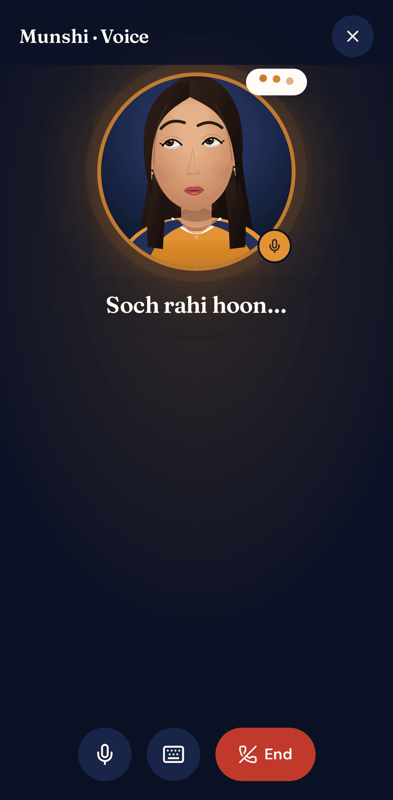 Phone</td>
</tr></table>

Ramesh ji says **"haan"**, or taps the button. Munshi then:

1. **phones the supplier** and places the order in Hindi, asking for a discount,
2. **reminds every customer who owes money**, each with their own amount and a Paytm/UPI payment link,
3. tells Ramesh ji what happened: *"Order pakka: ₹43,737, 4% chhoot (₹1,822 bacha), maal kal subah 11 baje. 41 customers ko reminder bheje."*

<table align="center"><tr>
<td width="72%" align="center"> Desktop</td>
<td width="28%" align="center">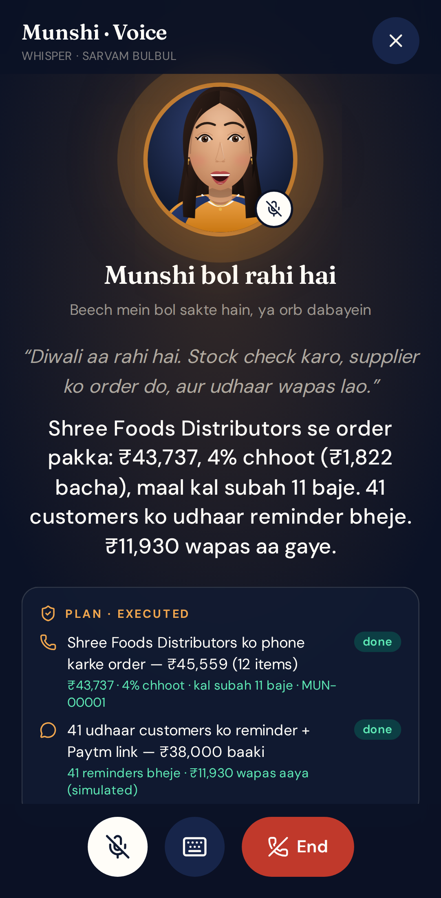 Phone</td>
</tr></table>

Everything is written down in **Activity**: what you asked, what you approved, what was done, the call transcript and every message sent.

<table align="center"><tr>
<td width="72%" align="center"> Desktop</td>
<td width="28%" align="center">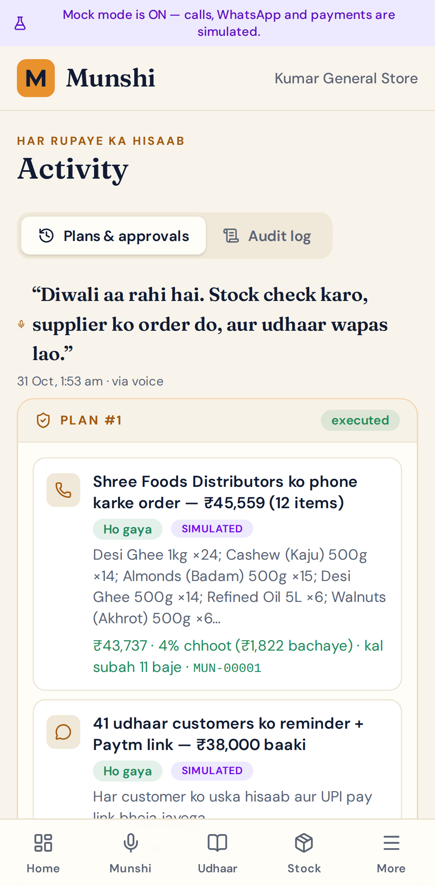 Phone</td>
</tr></table>

### 2. "Remind Manoj, but politely, and only on WhatsApp"

Not every reminder should go to everyone. Ramesh ji can name a single customer and a channel:

> *"Manoj ko udhaar wapas dene ka reminder bhej do, call pe nahi bas WhatsApp pe."*

Munshi picks out **Manoj Kapoor (₹1,430)**, prepares one WhatsApp message with a pay link, and asks first. It will not nag: **a customer is never reminded twice within 48 hours**, and if you ask anyway, Munshi tells you why it said no.

The **Udhaar ledger** is the digital version of the red notebook. You can add entries, tap **Remind** next to anyone, and mark payments received. Better still, you can **photograph the handwritten notebook page**. Munshi reads the names and amounts, shows them for you to check and correct, and only then adds them to the ledger.

<table align="center"><tr>
<td width="72%" align="center"> Desktop</td>
<td width="28%" align="center"> Phone</td>
</tr></table>

### 3. "Where did my regular customers go?"

Munshi keeps an eye on who used to visit every week and hasn't come for a month. Ramesh ji says *"purane customers ko offer bhejo"*. Munshi writes one friendly, Diwali-themed WhatsApp offer, addresses each person by name, and sends it to the ones who have gone quiet. It asks for approval first, like everything else.

<table align="center"><tr>
<td width="72%" align="center"> Desktop</td>
<td width="28%" align="center">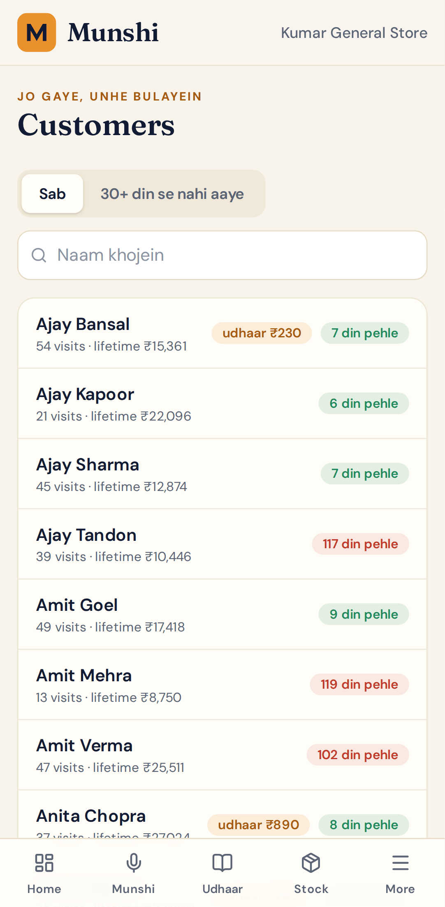 Phone</td>
</tr></table>

### 4. "Is my stock going to run out before the festival?"

The **Stock** page compares what sold during last year's festival with what is on the shelf today. Items that will run short are tagged *Tyohaar* and *Kam*, with the order quantity already worked out and arriving stock shown (*"+15 aa raha hai, kal subah 11 baje"*). Ramesh ji doesn't need a spreadsheet. He can just ask.

<table align="center"><tr>
<td width="72%" align="center"> Desktop</td>
<td width="28%" align="center"> Phone</td>
</tr></table>

### 5. "How did today go?" (and "I need cash to stock up")

At 10 pm every day, Munshi can send an **evening brief**: sales today, money collected, orders on the way, who still owes. The Home screen shows today's sales against the 7-day average, total udhaar and the stock gap at a glance. When Ramesh ji needs working capital, Munshi shows a **loan pre-offer** based on his Paytm sales.

<table align="center"><tr>
<td width="72%" align="center"> Desktop</td>
<td width="28%" align="center"> Phone</td>
</tr></table>

---

## Built for how shops really work

| You say / do | Munshi does |
|---|---|
| Talks in Hindi, Hinglish or English | Understands mixed languages and replies in the same one, in a natural Indian voice |
| Speaks while serving customers | Listens hands-free. You can interrupt Munshi mid-sentence, like a real conversation |
| Says **haan** or **nahi** | Treats it as approval or rejection, in Roman or Devanagari, and only for the plan waiting for you |
| Sends a WhatsApp voice note, or calls | Handles those channels too |
| Photographs the handwritten ledger | Reads it, lets you correct it, then adds it to the books |
| Is on a phone | Works like an app. Install it from Chrome. It is designed phone-first |

---

## You stay in control

Handing work to an AI should never feel risky. Munshi is built around that:

- **Plan first, act later.** Every plan appears as a card. You approve all of it, only part of it, or none.
- **Spending limits.** There is a maximum for any single order and a daily limit. Even an approved order is re-checked against them when it runs.
- **No nagging.** Customers aren't reminded twice within 48 hours, and a single batch of messages has a size limit.
- **Numbers come from your books, not from guesswork.** Quantities, amounts and who gets a message are calculated from your sales and ledger. The AI only decides *what kind* of thing to do.
- **A full record.** Every action is tied to the approval that triggered it, with the words you used and the time.
- **Safe set-up.** While you are getting started, all customer and supplier messages and calls can be redirected to your own phone so no real customer is contacted by mistake.

---

## All screens

Every screen of Munshi, on a desktop and on a phone.

### Welcome and sign-in

#### Landing page
One tap to try the live demo, or create your own shop.

<table align="center"><tr>
<td width="72%" align="center">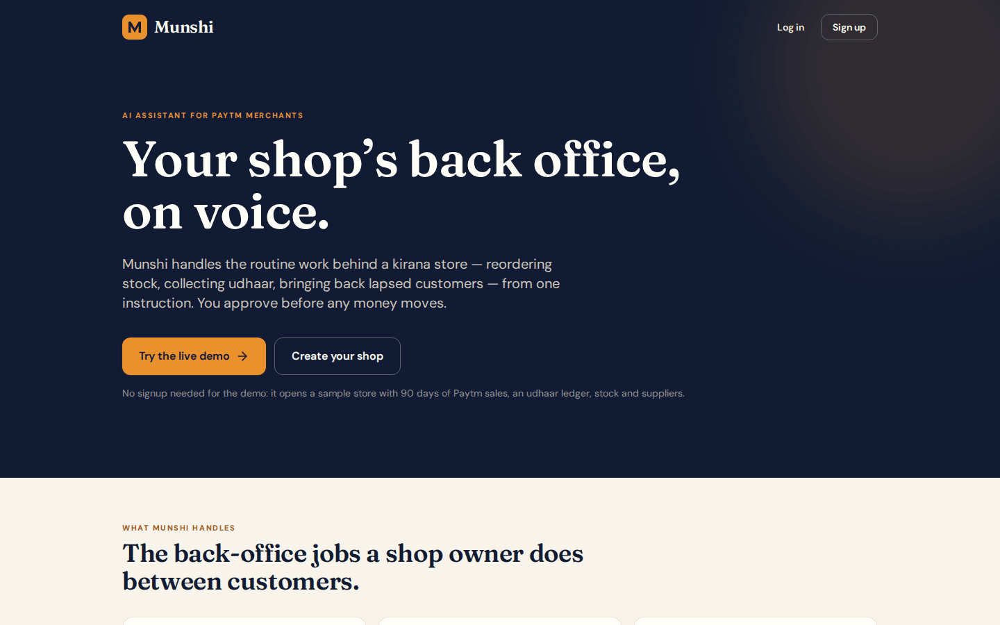 Desktop</td>
<td width="28%" align="center">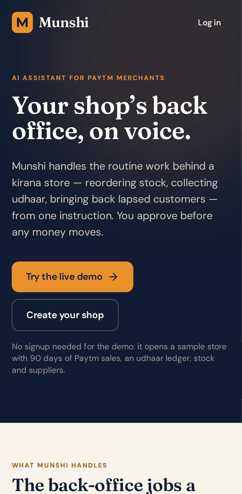 Phone</td>
</tr></table>

#### Log in
Email and password, or jump straight into the demo.

<table align="center"><tr>
<td width="72%" align="center">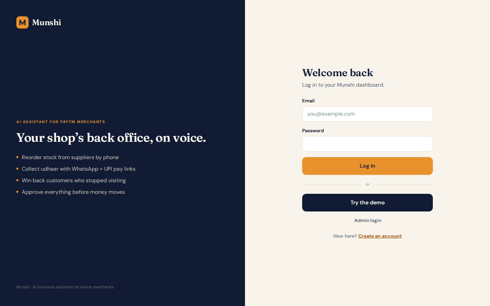 Desktop</td>
<td width="28%" align="center">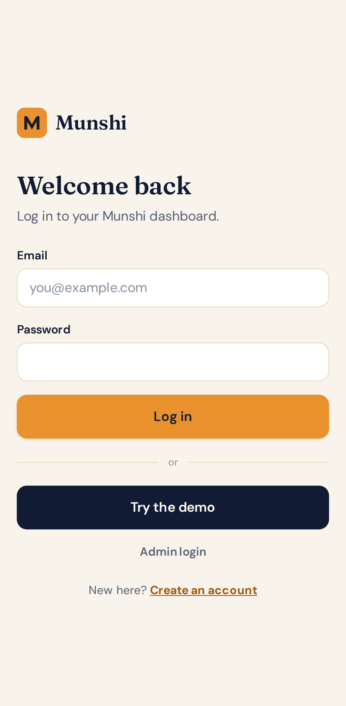 Phone</td>
</tr></table>

#### Sign up
Create your shop in a minute. Onboarding asks for the shop name, UPI ID and spending limits.

<table align="center"><tr>
<td width="72%" align="center">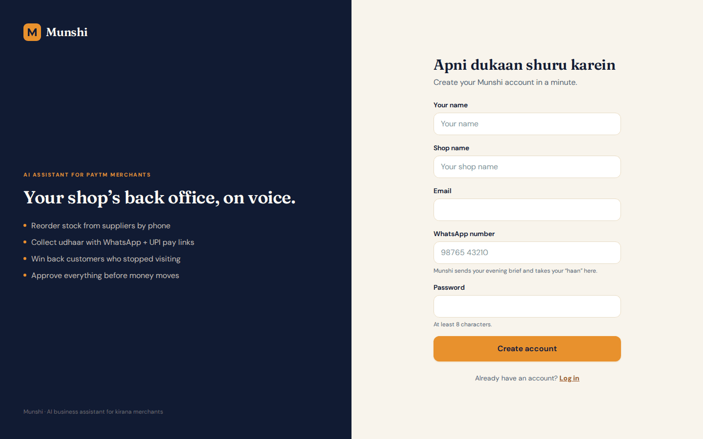 Desktop</td>
<td width="28%" align="center">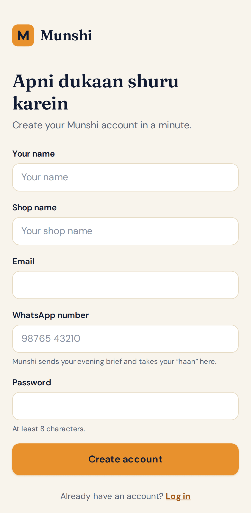 Phone</td>
</tr></table>

### Talking to Munshi

#### Voice screen: thinking
The assistant listens, then thinks. Her look changes with what she is doing.

<table align="center"><tr>
<td width="72%" align="center"> Desktop</td>
<td width="28%" align="center"> Phone</td>
</tr></table>

#### Voice screen: the plan
What Munshi wants to do, with Haan / Nahi right there, by voice or by tap.

<table align="center"><tr>
<td width="72%" align="center"> Desktop</td>
<td width="28%" align="center"> Phone</td>
</tr></table>

#### Voice screen: done
The result, spoken and shown.

<table align="center"><tr>
<td width="72%" align="center"> Desktop</td>
<td width="28%" align="center"> Phone</td>
</tr></table>

### Running the shop

#### Home
Today's sales, udhaar, stock gap, 30-day Paytm sales, evening brief, loan offer.

<table align="center"><tr>
<td width="72%" align="center"> Desktop</td>
<td width="28%" align="center"> Phone</td>
</tr></table>

#### Activity: plans and approvals
Every request, approval, call transcript and message.

<table align="center"><tr>
<td width="72%" align="center"> Desktop</td>
<td width="28%" align="center"> Phone</td>
</tr></table>

#### Activity: audit log
A timeline of everything Munshi did and who approved it.

<table align="center"><tr>
<td width="72%" align="center">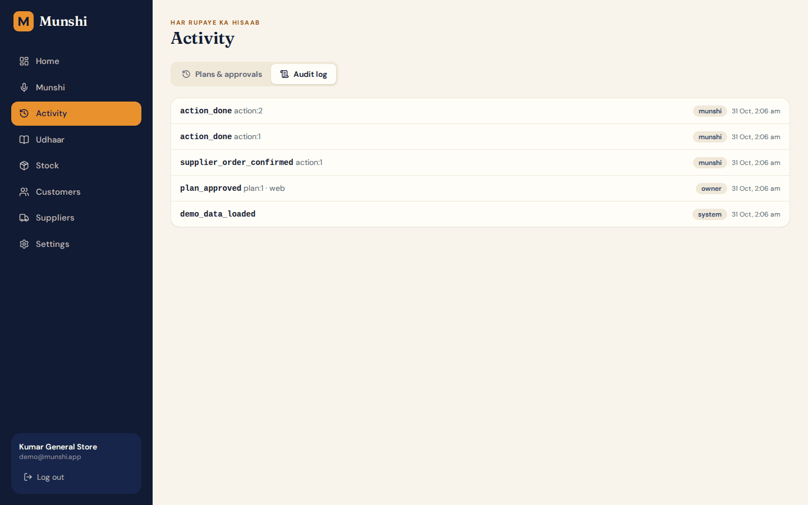 Desktop</td>
<td width="28%" align="center">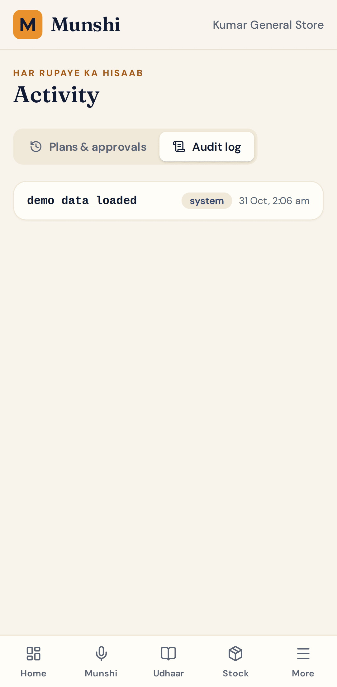 Phone</td>
</tr></table>

#### Udhaar ledger
Who owes what, one-tap reminders, notebook photo scan.

<table align="center"><tr>
<td width="72%" align="center"> Desktop</td>
<td width="28%" align="center"> Phone</td>
</tr></table>

#### Stock
Low stock and festival demand, with incoming orders.

<table align="center"><tr>
<td width="72%" align="center"> Desktop</td>
<td width="28%" align="center"> Phone</td>
</tr></table>

#### Customers
Regulars and the ones who have gone quiet.

<table align="center"><tr>
<td width="72%" align="center"> Desktop</td>
<td width="28%" align="center"> Phone</td>
</tr></table>

#### Suppliers
Your distributors and what you buy from each.

<table align="center"><tr>
<td width="72%" align="center">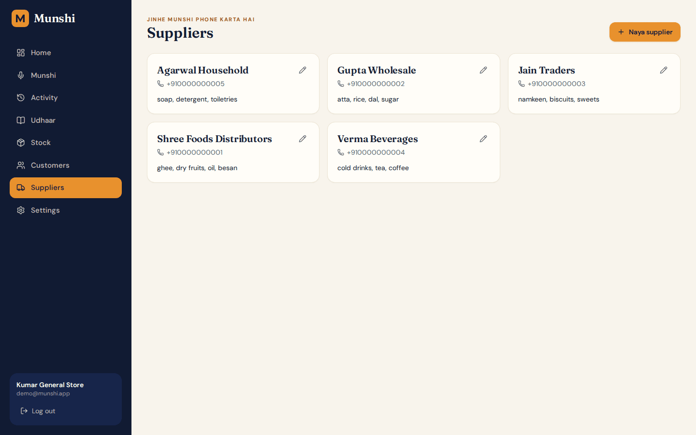 Desktop</td>
<td width="28%" align="center">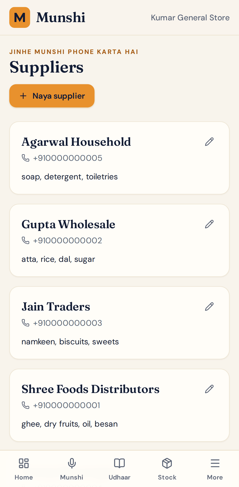 Phone</td>
</tr></table>

#### Settings
Shop profile, UPI ID, spending limits, your WhatsApp number, install as app.

<table align="center"><tr>
<td width="72%" align="center">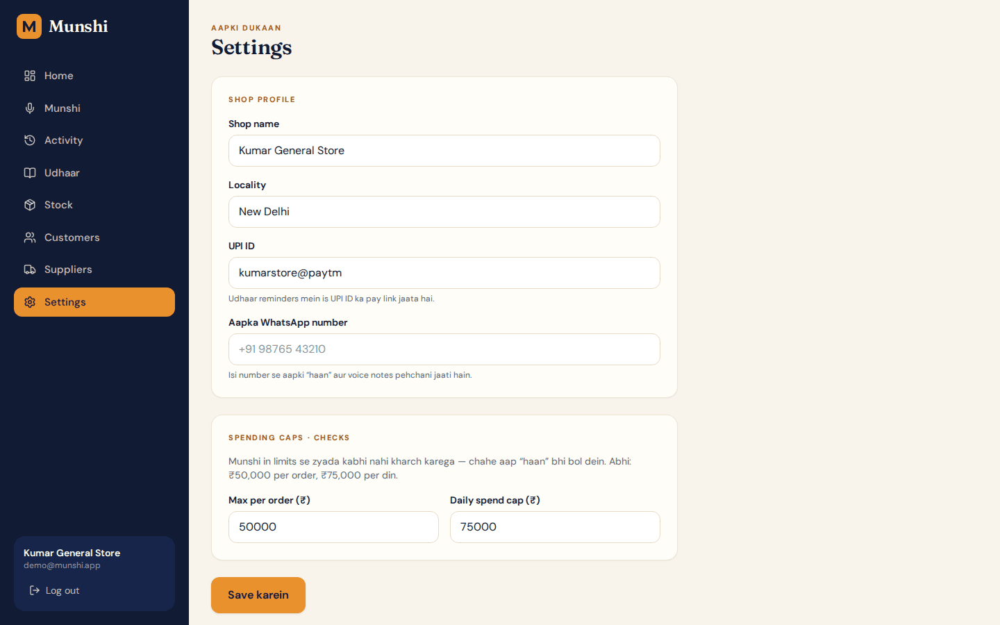 Desktop</td>
<td width="28%" align="center">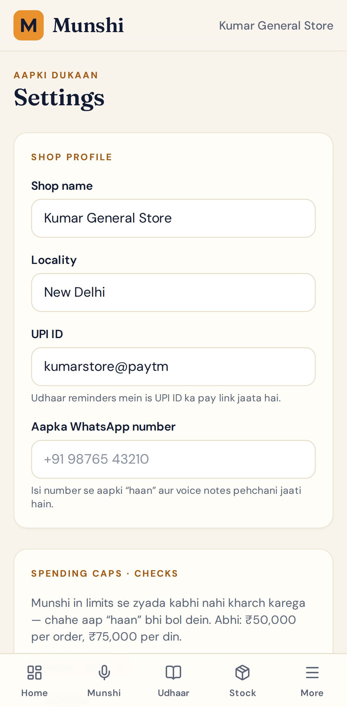 Phone</td>
</tr></table>

### On your phone

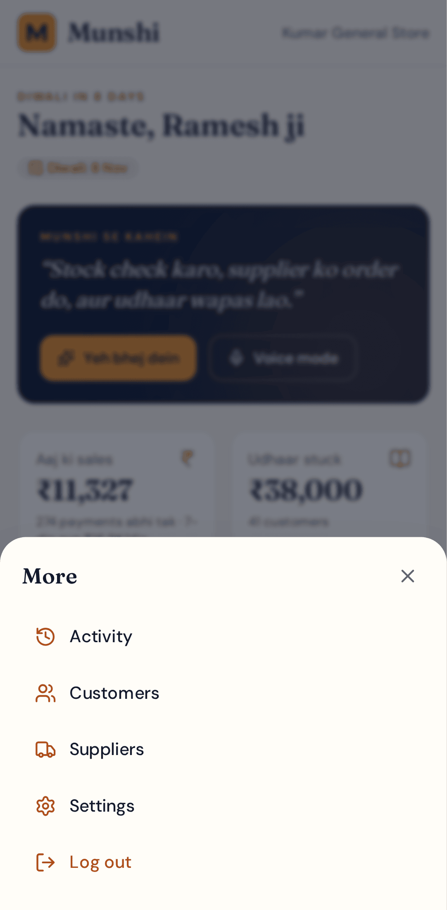

Everything is one tap away from the bottom bar and the More menu.

### Admin console

#### Providers
Choose the voice, connect Twilio for calls and WhatsApp, and set how reminders go out.

<table align="center"><tr>
<td width="72%" align="center">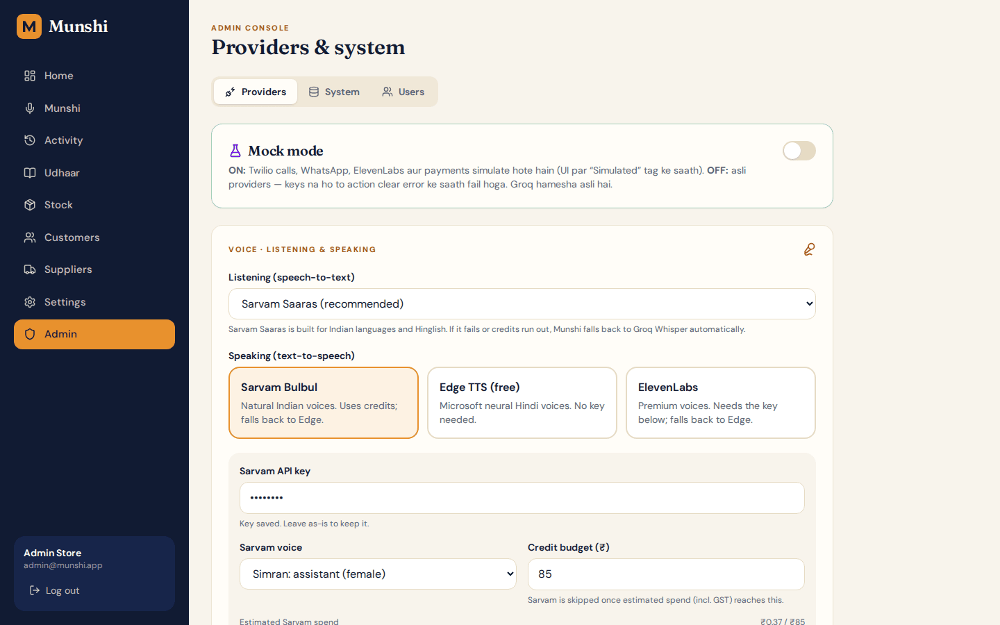 Desktop</td>
<td width="28%" align="center">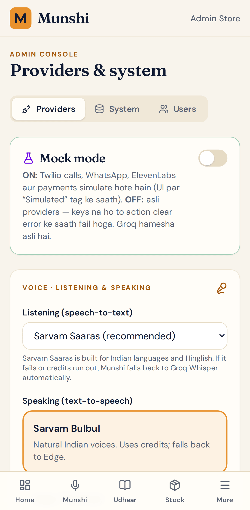 Phone</td>
</tr></table>

#### System
Usage and credit meters, database and service status.

<table align="center"><tr>
<td width="72%" align="center">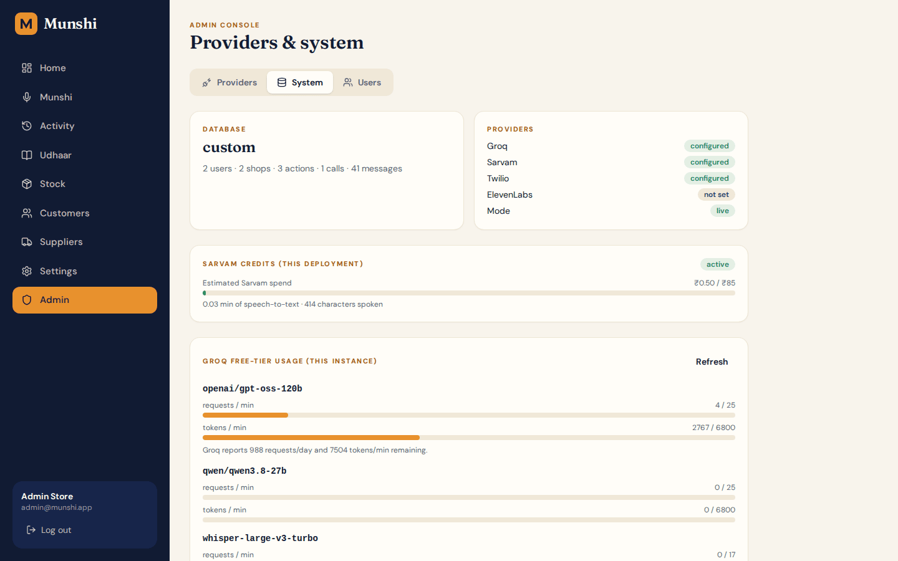 Desktop</td>
<td width="28%" align="center">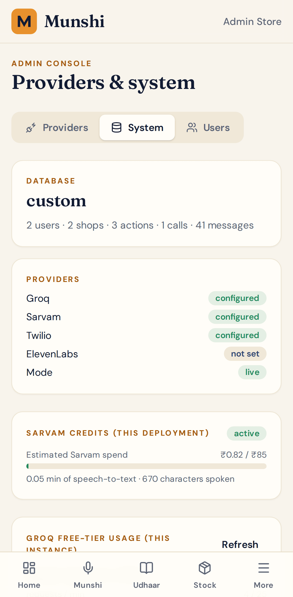 Phone</td>
</tr></table>

---

## For developers and operators

Setup, architecture, environment variables, connecting Twilio / Sarvam / ElevenLabs, testing and deployment are in the **[Technical guide → `TECHNICAL_README.md`](TECHNICAL_README.md)**.
