# Munshi — your shop's back office, on voice

**Munshi is an AI assistant for kirana and small-shop owners.** Talk to it in Hindi, Hinglish or English, like you would talk to a trusted munshi-ji behind the counter. Tell it what you need once, and it does the paperwork, the phone calls and the reminders. **Nothing involving money happens until you say "haan".**

### 👉 Try it now: **[munshi-web-navy.vercel.app](https://munshi-web-navy.vercel.app)**
Tap **Try the live demo**. No signup is needed. It opens a sample shop, *Kumar General Store*, with three months of Paytm sales, a ledger of customers who owe money, stock levels and suppliers. On a phone, use Chrome's **Install app** option to put Munshi on your home screen.

  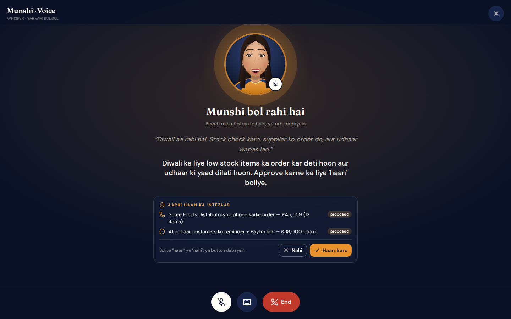

---

## Why a shop owner would want this

Running a kirana store means doing two jobs. One is serving customers, and the other is everything that happens *between* customers. That second job includes:

- noticing the ghee is nearly gone before Diwali, then phoning the distributor and haggling,
- remembering who owes you money, and asking without spoiling the relationship,
- wondering where your regular customers disappeared to,
- adding up the day's sales at night when you are tired.

Munshi takes that second job. You speak in your own words, it works out the details from your shop's data, and **it shows you what it plans to do before it does anything**.

---

## A day with Munshi: five scenarios

### 1. "Diwali is a week away. What should I stock?"

Ramesh ji is behind the counter, hands full of change. He opens Munshi and just says:

> *"Diwali aa rahi hai. Stock check karo, supplier ko order do, aur udhaar wapas lao."*

Munshi, in the voice of a calm, capable assistant, answers back: it looked at last year's Diwali sales, saw that ghee and dry fruits sold three times faster, found twelve items running low, and put together an order of **₹45,559** from his regular distributor. It also found **41 customers who owe ₹38,000** in total. It says what it plans to do and waits.

  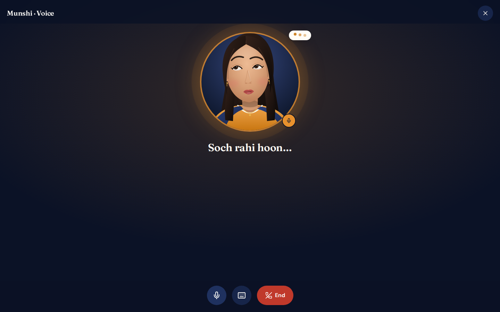
  &nbsp;
  

Ramesh ji says **"haan"**, or taps the button. Munshi then:

1. **phones the supplier**, speaking Hindi, to place the order and ask for a discount (in the demo, the supplier is simulated; with Twilio connected it is a real phone call),
2. **reminds every customer who owes money**, each with their own amount and a Paytm/UPI payment link,
3. tells Ramesh ji what happened: *"Order pakka: ₹43,737, 4% chhoot (₹1,822 bacha), maal kal subah 11 baje. 41 customers ko reminder bheje."*

  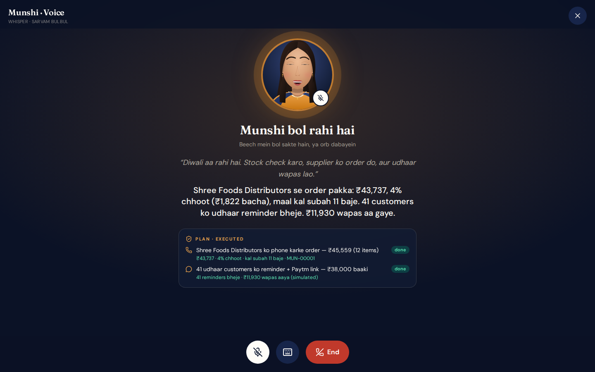

Everything is written down in **Activity**: what you asked, what you approved, what was done, the call transcript and every message sent.

  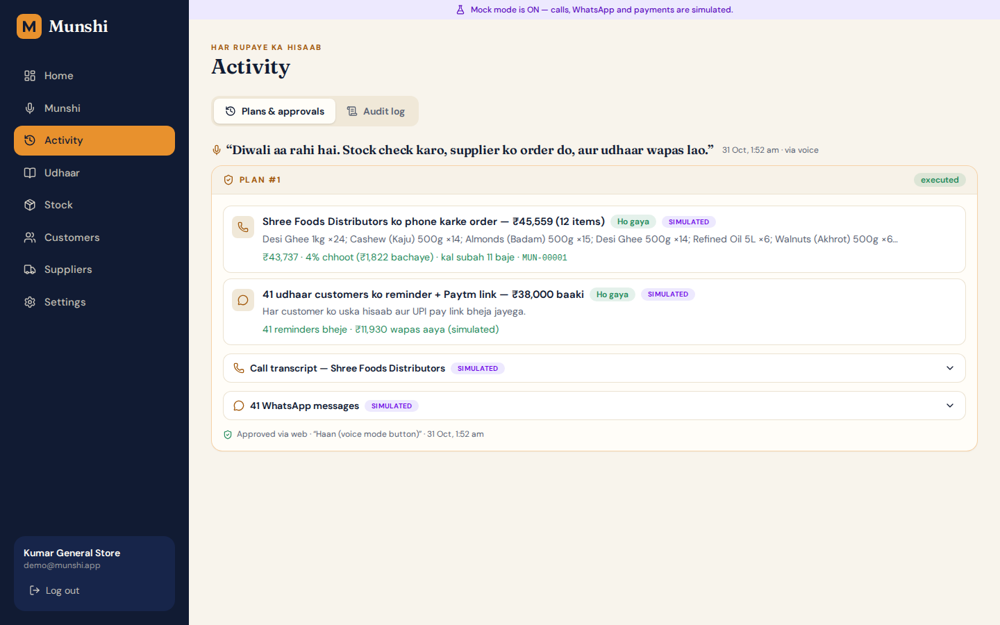

### 2. "Remind Manoj, but politely, and only on WhatsApp"

Not every reminder should go to everyone. Ramesh ji can name a single customer and a channel:

> *"Manoj ko udhaar wapas dene ka reminder bhej do, call pe nahi bas WhatsApp pe."*

Munshi picks out **Manoj Kapoor (₹1,430)**, prepares one WhatsApp message with a pay link, and asks first. It will not nag: **a customer is never reminded twice within 48 hours**, and if you ask anyway, Munshi tells you why it said no.

The **Udhaar ledger** is the digital version of the red notebook. You can add entries, tap **Remind** next to anyone, and mark payments received. Better still, you can **photograph the handwritten notebook page**. Munshi reads the names and amounts, shows them for you to check and correct, and only then adds them to the ledger.

  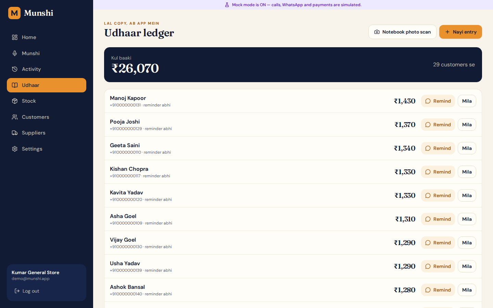

### 3. "Where did my regular customers go?"

Munshi keeps an eye on who used to visit every week and hasn't come for a month. Ramesh ji says *"purane customers ko offer bhejo"*. Munshi writes one friendly, Diwali-themed WhatsApp offer, addresses each person by name, and sends it to the ones who have gone quiet. It asks for approval first, like everything else.

  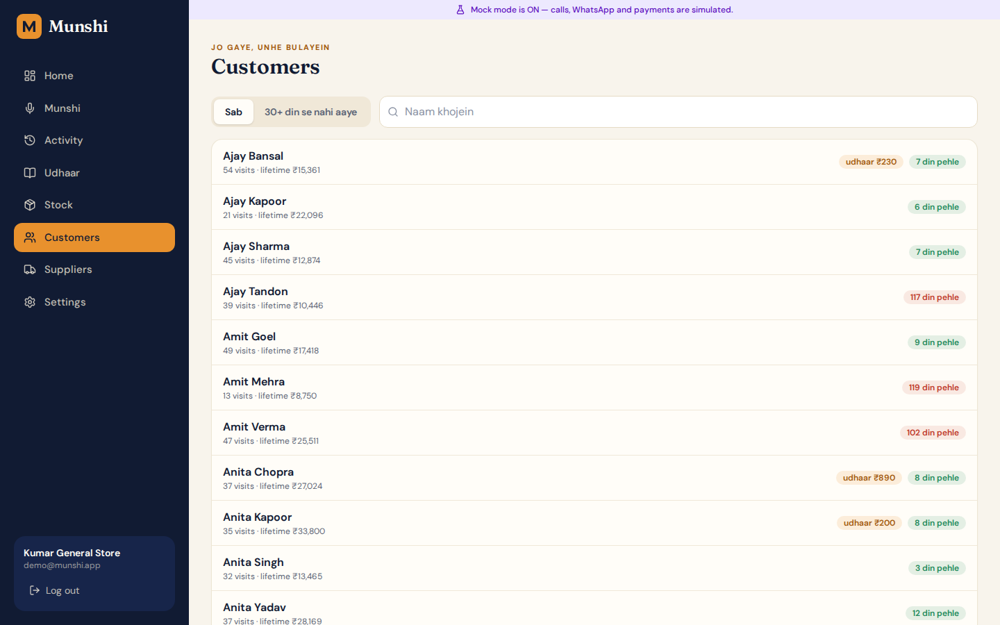

### 4. "Is my stock going to run out before the festival?"

The **Stock** page compares what sold during last year's festival with what is on the shelf today. Items that will run short are tagged *Tyohaar* and *Kam*, with the order quantity already worked out and arriving stock shown (*"+15 aa raha hai, kal subah 11 baje"*). Ramesh ji doesn't need a spreadsheet. He can just ask.

  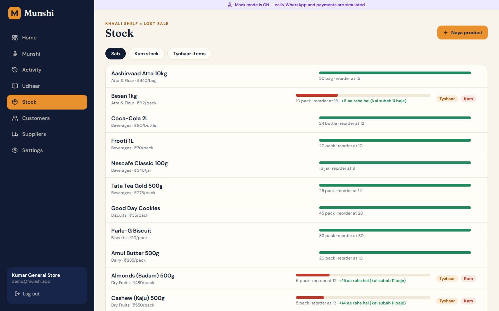

### 5. "How did today go?" (and "I need cash to stock up")

At 10 pm every day, Munshi can send an **evening brief**: sales today, money collected, orders in transit, who still owes. From the Home screen, Ramesh ji sees today's sales against his 7-day average, total udhaar, and the stock gap at a glance. When he needs working capital, Munshi can show a **loan pre-offer** based on his Paytm sales. *(In this demo the loan offer is only an illustration and is clearly labelled "simulated".)*

  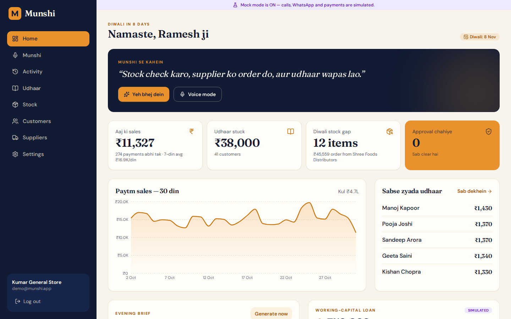

---

## Built for how shops really work

| You say / do | Munshi does |
|---|---|
| Talks in Hindi, Hinglish or English | Understands mixed languages and replies in the same one, in a natural Indian voice |
| Speaks while serving customers | Listens hands-free. You can interrupt Munshi mid-sentence, like a real conversation |
| Says **haan** or **nahi** | Treats it as approval or rejection, in Roman or Devanagari, and only for the plan waiting for you |
| Sends a WhatsApp voice note or calls | Handles those channels too, when connected |
| Photographs the handwritten ledger | Reads it, lets you correct it, then adds it to the books |
| Is on a phone | Works like an app. Install it from Chrome, and it is designed phone-first |

  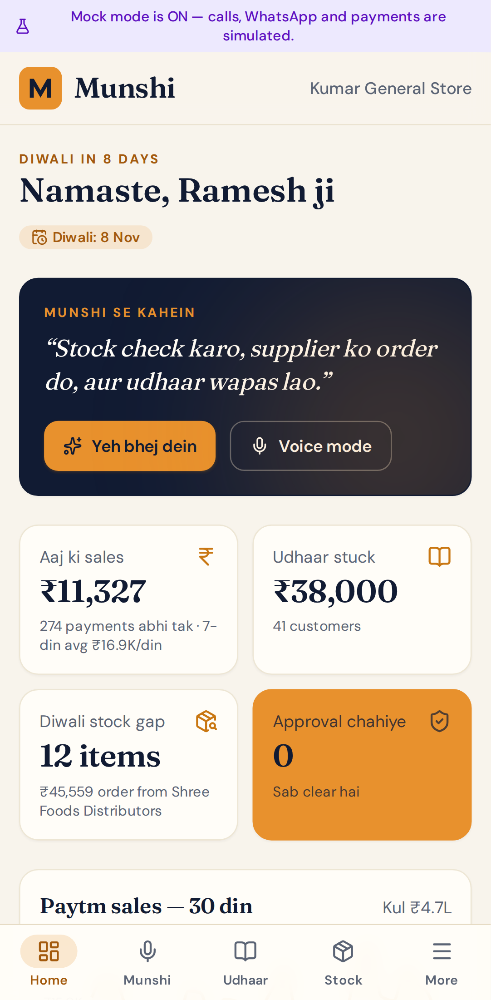
  &nbsp;
  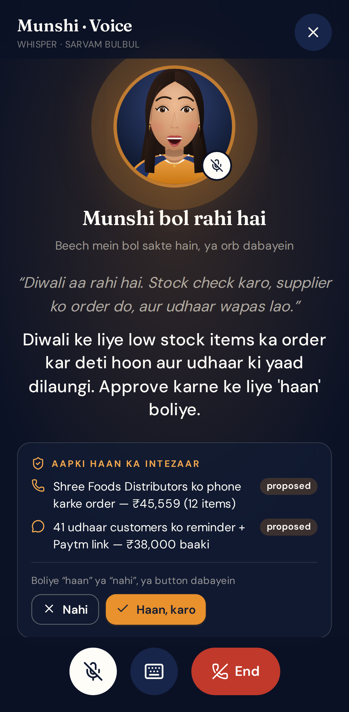
  &nbsp;
  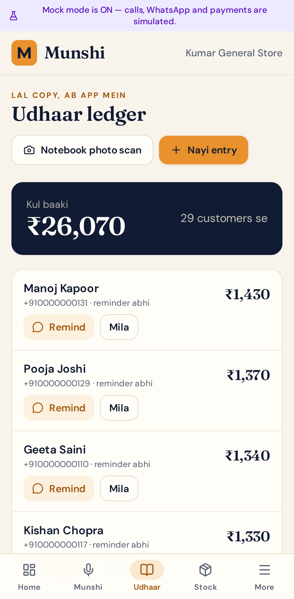
  &nbsp;
  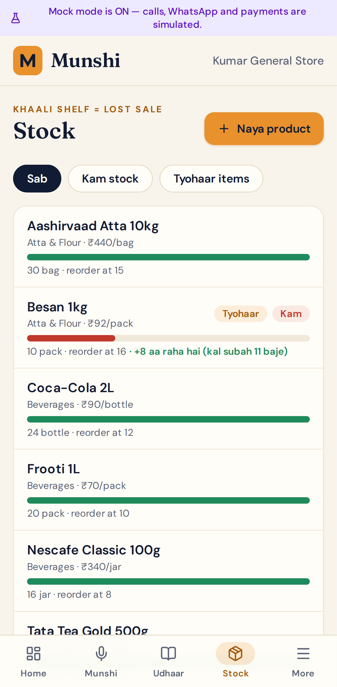

---

## You stay in control

Handing work to an AI should never feel risky. Munshi is built around that:

- **Plan first, act later.** Every plan appears as a card. You approve all of it, only part of it, or none.
- **Spending limits.** There is a maximum for any single order and a daily limit. Even an approved order is re-checked against them when it runs.
- **No nagging.** Customers aren't reminded twice within 48 hours, and a single batch of messages has a size limit.
- **Numbers come from your books, not from guesswork.** Quantities, amounts and who gets a message are calculated from your sales and ledger. The AI only decides *what kind* of thing to do.
- **A full record.** Every action is tied to the approval that triggered it, with the words you used and the time.
- **Safe testing.** While you are setting up, all customer and supplier messages and calls can be redirected to your own phone so no real customer is contacted by mistake.

---

## What's real today, and what's the demo

Being straight with you:

| | |
|---|---|
| ✅ **Working live** | The voice screen with the animated assistant; Hindi/Hinglish listening and speaking (Sarvam AI, with automatic fallbacks); planning and approvals; the udhaar ledger and photo scan; stock forecast; dashboard; installing as an app; outbound **phone calls** that speak in Hindi (tested on a real phone) |
| ⚠️ **Needs your Twilio account set up** | **WhatsApp messages.** Twilio's free trial only allows pre-approved message templates, so WhatsApp sending works once a template is linked (details in the technical guide). Supplier calls with live negotiation are built but still being tuned |
| 🧪 **A demo, by design** | The sample shop and its customers are made-up data. The loan offer is illustrative. The assistant is an animated illustration, not a video of a real person. In *practice mode* (the purple banner you may see) calls and messages are simulated and marked **Simulated**; nothing is actually sent |

---

## For developers and operators

Setup, architecture, environment variables, connecting Twilio / Sarvam / ElevenLabs, testing and deployment are in the **[Technical guide → `TECHNICAL_README.md`](TECHNICAL_README.md)**.
